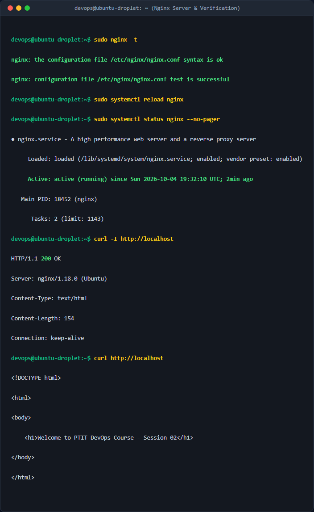

# Bài 2: Khởi chạy Web Server Nginx với Port Mapping

## Giới thiệu
Thực hiện khởi chạy Nginx Web Server chạy trong Docker container ở chế độ ngầm (`-d`), ánh xạ cổng (`-p`), kiểm tra phản hồi HTTP và dọn dẹp tài nguyên sau khi kiểm tra xong.

## Các thao tác thực hiện
1. Khởi chạy container từ image `nginx:alpine` với tên `my-web`, mở cổng `8080:80` ở chế độ ngầm.
2. Gửi yêu cầu HTTP bằng lệnh `curl http://localhost:8080` để kiểm tra phản hồi có chứa cụm từ "Welcome to nginx!".
3. Thực hiện dừng và xóa container `my-web` để dọn dẹp hệ thống.

## Hướng dẫn chạy

### Cách 1: Sử dụng file script.sh
```bash
chmod +x script.sh
./script.sh
```

### Cách 2: Chạy trực tiếp các lệnh Docker
```bash
# 1. Khởi chạy container
docker run -d -p 8080:80 --name my-web nginx:alpine
 
# 2. Kiểm tra trang web
curl http://localhost:8080
 
# 3. Dọn dẹp
docker stop my-web && docker rm my-web
```


## Ảnh chụp màn hình kết quả thực nghiệm

